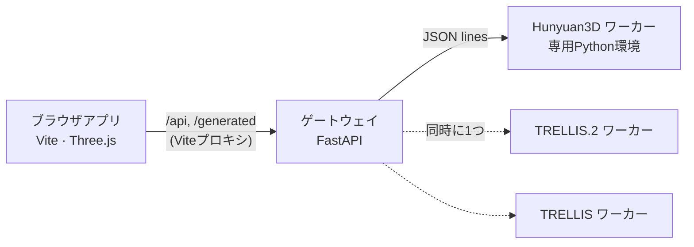

# Room Setup

[English](README.md) | **日本語** | [简体中文](README.zh-CN.md) | [한국어](README.ko.md)

2Dで間取りを描き、3Dで部屋を歩き回り、写真1枚から作った家具を置ける模様替えアプリです。すべてローカルで動きます。Webアプリは単体で使え、必要に応じて生成APIを起動すると、自分のGPUで **Hunyuan3D 2.1**・**TRELLIS.2**・**TRELLIS**・**Pixal3D**・**SAM 3D Objects** などの画像→3Dモデルを使えます。エンジンはアプリ上で切り替えられ、読み込みと解放はAPIが自動で行います。

## 任意の連携：部屋の写真から家具のある3Dの部屋へ

Room Setup・[itemsmith](https://github.com/maromocooo/itemsmith)・[glbsmith](https://github.com/maromocooo/glbsmith) は、それぞれ単独で使える独立したツールです。必要に応じて次の順につなげられます。

1. **itemsmith**：部屋の写真とヒントから製品候補・参照画像・寸法を調べ、ユーザーが正誤を確認します。
2. **glbsmith**：写真と幅・奥行き・高さをもとに、Codex / Claude Code が Blender でモデルを作り、GLB を出力します。
3. **Room Setup**：GLB を読み込み、2D/3D の部屋に配置します。

セットアップ、itemsmith → glbsmith の既存連携、Room Setup への手動読み込みは **[統合ガイド（英語）](docs/end-to-end.md)** を参照してください。製品・寸法・生成モデルの確認は必要で、部屋を完全自動で再現するものではありません。

手元に GLB があれば **家具 → GLB を読み込む** から単独で使えます。従来の画像→3D生成エンジンも引き続き選べます。連携先のアプリはローカルで動作しますが、選択したエージェントは外部サービスを利用します。

<p align="center">
  
</p>

## 動作の様子


## 使い方の例：買う前に自分の部屋で試す

ECサイトで気になる家具やガジェットを見つけたら、商品画像をスクショしてサイズを入れ、3Dモデルを生成します。実寸で自分の部屋に置けるので、注文する前にサイズ感や部屋との相性を確かめられます。


<sub>動画のショップは、自分で撮った写真から作ったデモ用のページです。生成部分は10倍速にしています。</sub>

## できること

<table>
  <tr>
    <td width="50%"></td>
    <td width="50%"></td>
  </tr>
</table>

- **間取りエディタ**：グリッドと角へのスナップ付きで壁を描画。Shiftで角度固定、角や壁をドラッグして変形（つながった壁も追従）、元に戻す／やり直し、パン・ズーム、長方形・L字テンプレート、壁の長さと床面積を表示。
- **ドア・窓**：片開き・両開き・引き戸・開口のみのドア、引き違い・掃き出し・FIX・縦すべり出し・高窓の窓。幅・高さ・床からの高さを設定でき、壁に沿ってドラッグで移動、ドアの吊元や開く向きも切り替えられます。3Dでは壁に開口を開けて枠やガラスまで表示します。どの窓にもカーテンを付けられ、素材と自由な色を選んで、タッセルで留めるところまで開き具合を調整できます。
- **照明**：生成したランプなどの家具に光源を付けられます（家具と一緒に動きます）。シーリングライト・ペンダント・ダウンライト・スポット・フロアランプ・テーブルランプも置けます。明るさ（ルーメン）・色温度・影を設定し、間取りでのドラッグや3Dの矢印で位置を調整。朝・昼・夕方・夜を切り替えられ、昼は窓から日が差し込みます。
- **3D表示**：影と環境光、カメラ側の壁を自動で低くするカットアウェイ表示、全体／真上／室内目線のカメラ、家具の移動・回転ギズモ。
- **ウォークモード**：ゲームのように目線の高さで部屋を歩けます。WASD／矢印キーで移動、マウスで視点、Shift で走る。壁や背の高い家具にはぶつかり、ドアは通り抜けられます。
- **内装**：床材・壁紙のプリセット、柄の大きさ、手持ちの写真をテクスチャとして使用、壁ごとの壁紙変更。
- **写真から家具**：画像をドロップまたは貼り付けて、幅×奥行き×高さを入力し、エンジンを選んで生成。複数のジョブをキューに入れられ、進み具合を表示し、完成したモデルは指定寸法に合わせて部屋に置かれます。家具は間取り図にも表示され、ドラッグで動かせます。
- **形の調整**：上下逆や横倒しで生成されたモデルの向きを直したり、全体の比率を変えたり、頂点を選んで部分的に変形したりできます。
- **AIアシスタントで作る**：MCPサーバー経由で、Claude（画像を理解できるMCPクライアントなら他でも可）が写真・間取り図・商品リンクから部屋を再現します。変更はアプリにリアルタイムで反映されます。[docs/mcp.ja.md](docs/mcp.ja.md) を参照。
- **プロジェクト**：壁・内装・家具モデル・サムネイルをまとめて1つのZIPに保存・読込。元の Room Designer で保存したプロジェクトも開けます。
- ライト／ダークテーマ、日本語／英語UI、キーボードショートカット。

## クイックスタート

必要なもの：Node.js 22.12以上、WebGL対応のデスクトップブラウザ。生成APIにはPython 3.10以上が必要です。

```bash
npm ci
npm run dev            # http://127.0.0.1:5173
```

間取り・内装・保存済みプロジェクトの読込はAPIなしで使えます。GPUなしで生成の流れを試すには、箱を返すモックエンジン付きでAPIを起動します：

```bash
python3 -m venv .venv
.venv/bin/pip install -r server/requirements.txt
ROOM_SETUP_MOCK_ENGINE=1 npm run api      # 別のターミナルで
```

## 生成エンジン


| エンジン | 出力 | 備考 |
|---|---|---|
| [Hunyuan3D 2.1](https://github.com/Tencent-Hunyuan/Hunyuan3D-2.1) | 形状＋任意でPBRテクスチャ | テクスチャ生成は時間がかかり、GPUメモリも多く使います。独自の制限付きライセンスです（後述）。 |
| [TRELLIS.2](https://github.com/microsoft/TRELLIS.2) | 形状＋PBRマテリアル | 最も精細。 |
| [TRELLIS](https://github.com/microsoft/TRELLIS) | 色付きメッシュ | 高速。 |
| [Pixal3D](https://github.com/TencentARC/Pixal3D) | 形状＋PBRマテリアル | 写真に忠実。MITだがMetaのDINOv3（独自ライセンス）を読み込む。 |
| [SAM 3D Objects](https://github.com/facebookresearch/sam-3d-objects) | テクスチャ付きメッシュ | 散らかった実写写真に強い。MetaのSAM License、重みはゲート付き。 |

### 必要なGPUメモリ

どのエンジンもCUDA対応のNVIDIA GPUが必要です。動作確認はLinux＋RTX 4090（24GB）で行っています。

| エンジン | 最低VRAM | 推奨 |
|---|---|---|
| Hunyuan3D 2.1 | 10GB（形状のみ） | 24GB（テクスチャあり。テクスチャ生成だけで約21GB） |
| TRELLIS.2 | 24GB | 24GB以上 |
| TRELLIS | 16GB | 16GB以上 |
| Pixal3D | 24GB（省VRAMモード。本プロジェクトの既定） | 24GB以上 |
| SAM 3D Objects | 本プロジェクトの設定で24GB（公式の要件は32GB） | 32GB |

注記のないものは各公式リポジトリの値です。GPUを使うエンジンは常に1つだけなので、導入するエンジンのうち最も大きい要件が必要になります。

各エンジンはそれぞれ専用のPython環境で動きます。本プロジェクトにはモデルのコードや重みを同梱しません。使いたいエンジンを公式手順で導入し、APIにパスを設定してください：

```bash
cp .env.example .env    # HUNYUAN3D_PYTHON / HUNYUAN3D_ROOT、TRELLIS2_…、TRELLIS_… を設定
npm run api
```

アプリのエンジン一覧に、設定済みかどうかと状態（待機中・読み込み中・準備完了など）が表示されます。選んだエンジンはジョブで必要になった時点で読み込まれ、それまでGPUを使っていたエンジンは先に終了します。VRAMを使うモデルは常に1つだけです。導入方法、GPUメモリ、トラブル対処、エンジンの追加方法は **[docs/engines.ja.md](docs/engines.ja.md)** を参照してください。

## アシスタントに部屋を作ってもらう

APIとアプリを起動した状態で、MCPサーバーをアシスタントに登録します：

```bash
claude mcp add room-setup -- "$PWD/.venv/bin/python" "$PWD/server/mcp_server.py"
```

あとは部屋の写真（中央から四隅に向けて撮影）、間取り図、家具のリンクを渡して「部屋を作って」と頼むだけです。Claude Desktopでの設定、コツ、ツール一覧は **[docs/mcp.ja.md](docs/mcp.ja.md)** にあります。

## 使い方

1. **部屋** タブ：テンプレートを選ぶか、間取りで壁を描きます（`W`）。`V` で角や壁を移動、`E` で削除。天井の高さを設定します。**ドア・窓** でプリセットを選んで壁をクリックすると配置でき、選択するとサイズ・床からの高さ・開く向きを変更できます。
2. **内装** タブ：床材と壁紙を選び、柄の大きさを調整します。「＋」で手持ちの画像も使えます。1枚の壁だけ変えるときは、間取りでその壁を選んで「選択中の壁だけ」を選びます。
3. **家具** タブ：写真をドロップ／貼り付けしてサイズを入力し、エンジンを選んで **3Dモデルを生成**。複数まとめてキューに入れられます。
4. **3D** に切り替えて見回し、家具をクリックで選択、ギズモで動かします。インスペクタで名前・位置・向きの変更、複製、削除、形の調整ができます。
5. **保存** でプロジェクトを ZIP でダウンロードします（名前をつけるまでは `room-project.zip`）。隣の ▼ の **名前をつけて保存** ではファイル名を選べます。**開く** で復元します。以降の保存は、保存または開いたファイルの名前を引き継ぎます。APIの起動中は今の部屋をAPIも保持しているので、再読み込みしても元に戻ります。APIなしで使う場合は自動保存されません。

| ショートカット | 動作 |
|---|---|
| `W` / `V` / `E` | 壁を描く／選択・移動／削除（間取り） |
| 描画中に `Shift` | 45°刻みに固定 |
| `Space`＋ドラッグ、中・右ドラッグ、ホイール | 間取りのパン・ズーム |
| `F` | 間取りを全体表示 |
| `Ctrl+Z` / `Ctrl+Shift+Z` | 元に戻す / やり直す（壁、ドア・窓、内装、照明、家具。両方の画面のボタンでも可） |
| `R` / `Shift+R` | 選択中の家具を90°回転 |
| `Delete` | 選択中の家具または壁を削除 |
| `Ctrl+S` | プロジェクトを保存 |
| `Ctrl+Shift+S` | 名前をつけて保存 |
| `Esc` | キャンセル／選択解除 |

## 構成



ブラウザは自分自身のオリジンにだけアクセスし、ViteがAPIへ転送します。そのためゲートウェイは `127.0.0.1` のままでよく、CORS設定も不要です。開発者向けメモとAPIリファレンスは [docs/development.md](docs/development.md) にあります。

## 画像の扱いについて

生成に使う写真（通販サイトの商品画像など）は、たいてい他人の著作物です。使う権利のある画像だけを使ってください。他人の画像から生成したモデルは、自分の部屋の検討など個人の範囲で使い、再配布や販売はしないでください。テクスチャにロゴや商標が写り込む場合にも注意してください。いちばん安心なのは、自分で撮った写真を使うことです。

## セキュリティ

自分のPCで1人で使うためのツールです。アプリにもAPIにも **認証はありません**（ほかのWebサイトからのリクエストはAPIが拒否します）。どちらもlocalhostにバインドしたまま（既定値）使ってください。`HOST=0.0.0.0` でLANに公開する場合は信頼できるネットワークに限り、インターネットには絶対に公開しないでください。

## ライセンス

Room Setup 本体のコードは [MIT](LICENSE) です。生成エンジン・モデルの重み・生成物にはそれぞれの条件が適用されます。特に **Tencent Hunyuan 3D 2.1** には地域制限などの条件があり、本プロジェクトのMITライセンスによって変わることはありません。生成したモデルを利用・配布する前に [THIRD_PARTY_NOTICES.md](THIRD_PARTY_NOTICES.md) を確認してください。

コントリビューション歓迎です。[CONTRIBUTING.md](CONTRIBUTING.md) を参照してください。
