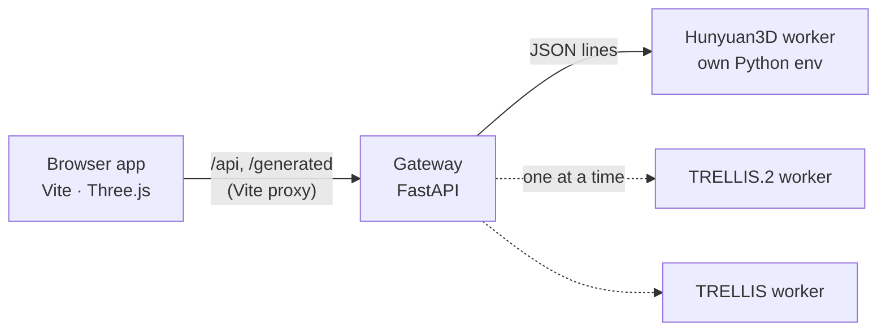

# Room Setup

[English](README.md) | [日本語](README.ja.md) | [简体中文](README.zh-CN.md) | **한국어**

2D로 방을 설계하고, 3D로 둘러보고, 사진 한 장으로 만든 가구를 배치하세요. 모든 것이 로컬에서 실행됩니다. 웹 앱은 단독으로 동작하며, 선택 사항인 생성 API가 여러분의 GPU에서 **Hunyuan3D 2.1**, **TRELLIS.2**, **TRELLIS**, **Pixal3D**, **SAM 3D Objects** 같은 이미지-3D 모델을 구동합니다. 앱에서 엔진을 전환할 수 있고, API가 알아서 로드와 언로드를 처리합니다.

<p align="center">
  
</p>

## 동작 모습


## 기능

<table>
  <tr>
    <td width="50%"></td>
    <td width="50%"></td>
  </tr>
</table>

- **평면도 편집기**: 그리드와 모서리 스냅으로 벽 그리기, Shift로 각도 고정, 모서리나 벽 전체 드래그(연결된 벽이 따라옴), 실행 취소/다시 실행, 이동과 확대/축소, 직사각형·L자형 템플릿, 길이와 바닥 면적 실시간 표시.
- **문과 창문**: 여닫이문, 양여닫이문, 미닫이문, 문 없는 개구부; 미서기 창, 테라스 창, 고정창, 여닫이 창, 고창. 너비, 높이, 창턱 높이를 설정하고 벽을 따라 드래그하며 문의 경첩 방향이나 열리는 방향을 뒤집을 수 있습니다. 3D 벽에 프레임과 유리가 있는 개구부로 뚫립니다.
- **조명**: 생성한 스탠드에 함께 움직이는 광원을 달거나, 천장등, 펜던트, 다운라이트, 스포트라이트, 플로어 스탠드, 테이블 스탠드를 배치합니다. 밝기(루멘), 색온도, 그림자를 설정하고, 평면도나 3D 화살표로 조명을 옮기며, 아침·낮·저녁·밤을 전환하면 창문으로 햇빛이 들어옵니다.
- **3D 방**: 그림자, 환경 조명, 카메라 쪽 벽을 낮춰 보여 주는 단면(돌하우스) 보기, 전체/위/눈높이 카메라, 가구 이동·회전 기즈모.
- **마감재**: 절차적으로 생성되는 바닥재와 벽지 프리셋, 패턴 크기 조정, 직접 찍은 사진을 텍스처로 사용, 벽마다 다른 벽지.
- **사진으로 가구 만들기**: 이미지를 드롭하거나 붙여 넣고, 너비 × 깊이 × 높이를 입력한 뒤 엔진을 골라 생성합니다. 작업은 대기열에 쌓이고 진행 상황이 표시되며, 결과는 입력한 치수에 맞게 크기가 조정되어 방에 배치됩니다. 가구는 평면도에도 표시되어 드래그로 옮길 수 있습니다.
- **형태 보정**: 위아래가 뒤집히거나 옆으로 눕게 생성된 모델을 바로 세우고, 전체 비율을 조정하거나, 정점을 선택해 모델의 일부를 변형할 수 있습니다.
- **AI 어시스턴트로 만들기**: MCP 서버를 통해 Claude(또는 이미지를 이해하는 다른 MCP 클라이언트)가 사진, 평면도, 상품 링크로 방을 재현합니다. 변경 사항은 앱에 실시간으로 반영됩니다. [docs/mcp.md](docs/mcp.md)를 참고하세요.
- **프로젝트**: 모든 내용(벽, 마감재, 가구 모델, 썸네일)을 하나의 ZIP으로 저장하고 열 수 있습니다. 기존 Room Designer 앱의 프로젝트도 열립니다.
- 라이트/다크 테마, 일본어·영어 UI, 키보드 단축키.

## 빠른 시작

요구 사항: Node.js 22.12+, WebGL을 지원하는 데스크톱 브라우저. 생성 API에는 Python 3.10+가 필요합니다.

```bash
npm ci
npm run dev            # http://127.0.0.1:5173
```

설계, 마감재, 저장한 프로젝트 열기는 API 없이 동작합니다. GPU 없이 생성 흐름을 체험하려면 내장 모의 엔진으로 API를 실행하세요(상자 하나를 반환합니다).

```bash
python3 -m venv .venv
.venv/bin/pip install -r server/requirements.txt
ROOM_SETUP_MOCK_ENGINE=1 npm run api      # 두 번째 터미널에서
```

## 생성 엔진


| 엔진 | 출력 | 비고 |
|---|---|---|
| [Hunyuan3D 2.1](https://github.com/Tencent-Hunyuan/Hunyuan3D-2.1) | 형상, 선택적 PBR 텍스처 | 텍스처 생성은 느리고 GPU 메모리를 더 사용합니다. 더 제한적인 자체 라이선스가 있습니다(아래 참고). |
| [TRELLIS.2](https://github.com/microsoft/TRELLIS.2) | PBR 재질이 있는 형상 | 가장 정밀한 결과. |
| [TRELLIS](https://github.com/microsoft/TRELLIS) | 색상이 있는 메시 | 빠름. |
| [Pixal3D](https://github.com/TencentARC/Pixal3D) | PBR 재질이 있는 형상 | 사진에 충실합니다. MIT이지만 Meta의 DINOv3(별도 라이선스)를 내려받습니다. |
| [SAM 3D Objects](https://github.com/facebookresearch/sam-3d-objects) | 텍스처가 있는 메시 | 어수선한 실제 사진에도 강합니다. Meta SAM License, 가중치는 접근 신청이 필요합니다. |

각 엔진은 자체 Python 환경에서 실행되며, 이 프로젝트는 모델 코드나 가중치를 포함하지 않습니다. 원하는 엔진을 각 업스트림 안내에 따라 설치한 뒤 API에 위치를 알려 주세요.

```bash
cp .env.example .env    # HUNYUAN3D_PYTHON / HUNYUAN3D_ROOT, TRELLIS2_…, TRELLIS_… 설정
npm run api
```

앱의 엔진 목록에서 어떤 엔진이 설정되어 있는지, 그리고 각 엔진이 대기 중·로딩 중·준비 완료 중 어떤 상태인지 확인할 수 있습니다. 선택한 엔진은 작업에 필요할 때 로드되며, 그 전에 GPU를 쓰던 엔진은 먼저 종료되므로 VRAM에는 항상 모델 하나만 올라갑니다. 설치 방법, GPU 메모리, 문제 해결, 엔진 추가 방법은 **[docs/engines.md](docs/engines.md)**를 참고하세요.

## 어시스턴트로 방 만들기

API와 앱을 실행한 상태에서 어시스턴트에 MCP 서버를 등록합니다.

```bash
claude mcp add room-setup -- "$PWD/.venv/bin/python" "$PWD/server/mcp_server.py"
```

그런 다음 방 사진(방 가운데에서 각 모서리를 향해 촬영), 평면도, 가구 링크를 보내고 방을 만들어 달라고 요청하세요. Claude Desktop 설정, 팁, 도구 목록은 **[docs/mcp.md](docs/mcp.md)**에 있습니다.

## 사용 방법

1. **방** 탭: 템플릿을 고르거나 평면도에 벽을 그립니다(`W`). `V`로 모서리와 벽을 옮기고 `E`로 지웁니다. 천장 높이를 설정합니다. **문과 창문**에서 프리셋을 고르고 벽을 클릭해 배치하며, 선택하면 크기, 창턱 높이, 열리는 방향을 바꿀 수 있습니다.
2. **마감재** 탭: 바닥재와 벽지를 고르고 패턴 크기를 조정하거나 “+”로 직접 고른 이미지를 사용합니다. 벽 하나만 바꾸려면 평면도에서 그 벽을 선택하고 “선택한 벽만”을 고르세요.
3. **가구** 탭: 사진을 드롭/붙여 넣고 크기를 입력한 뒤 엔진을 골라 **3D 모델 생성**을 클릭합니다. 여러 개를 대기열에 넣을 수 있습니다.
4. **3D**로 전환해 둘러보고, 가구를 클릭해 선택한 뒤 기즈모를 드래그합니다. 인스펙터에서 이름 변경, 위치, 회전, 복제, 삭제, 형태 조정을 할 수 있습니다.
5. **저장**은 `room-project.zip`을 내려받고, **열기**로 복원합니다. API가 실행 중이면 현재 방은 API에도 보관되어 새로 고침 후에도 돌아옵니다. API가 없으면 자동 저장되지 않습니다.

| 단축키 | 동작 |
|---|---|
| `W` / `V` / `E` | 벽 그리기 / 선택·이동 / 지우기(평면도) |
| 그리는 중 `Shift` | 45° 단위로 고정 |
| `Space` + 드래그, 가운데 또는 오른쪽 드래그, 휠 | 평면도 이동과 확대/축소 |
| `F` | 평면도를 화면에 맞춤 |
| `Ctrl+Z` / `Ctrl+Shift+Z` | 벽 실행 취소 / 다시 실행 |
| `R` / `Shift+R` | 선택한 가구를 90° 회전 |
| `Delete` | 선택한 가구나 벽 삭제 |
| `Ctrl+S` | 프로젝트 저장 |
| `Esc` | 취소 / 선택 해제 |

## 구성



브라우저는 자신의 오리진과만 통신하고 Vite가 API 호출을 전달하므로, 게이트웨이는 `127.0.0.1`에 머무르며 CORS가 필요 없습니다. 개발자 노트와 API 레퍼런스는 [docs/development.md](docs/development.md)에 있습니다.

## 보안

이 도구는 자신의 컴퓨터에서 쓰는 1인용 도구입니다. 앱과 API에는 **인증이 없습니다**(API는 다른 웹사이트에서 온 요청을 거부합니다). 둘 다 localhost에만 바인딩해 두세요(기본값). `HOST=0.0.0.0`으로 개발 서버를 LAN에 공개한다면 신뢰할 수 있는 네트워크에서만 사용하고, 공용 인터넷에는 절대 노출하지 마세요.

## 라이선스

Room Setup 자체 코드는 [MIT](LICENSE) 라이선스입니다. 생성 엔진, 모델 가중치와 그 출력물에는 각자의 조건이 적용됩니다. 특히 **Tencent Hunyuan 3D 2.1**에는 지역 제한과 기타 조건이 있으며, 이 프로젝트의 MIT 라이선스가 이를 바꾸지 않습니다. 생성한 모델을 사용하거나 배포하기 전에 [THIRD_PARTY_NOTICES.md](THIRD_PARTY_NOTICES.md)를 읽어 주세요.

이 번역은 참고용이며, 내용이 다를 경우 [영어판](README.md)이 우선합니다.

기여를 환영합니다. [CONTRIBUTING.md](CONTRIBUTING.md)를 참고하세요.
