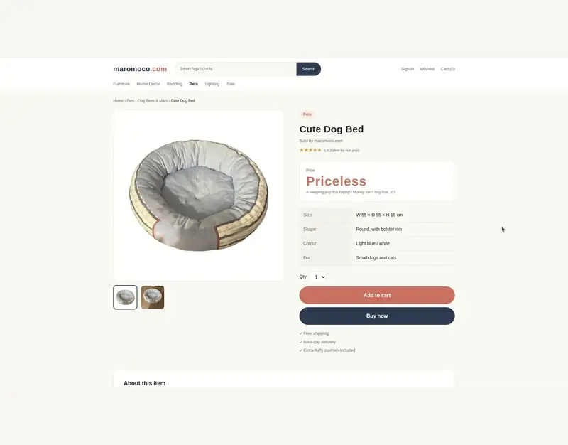
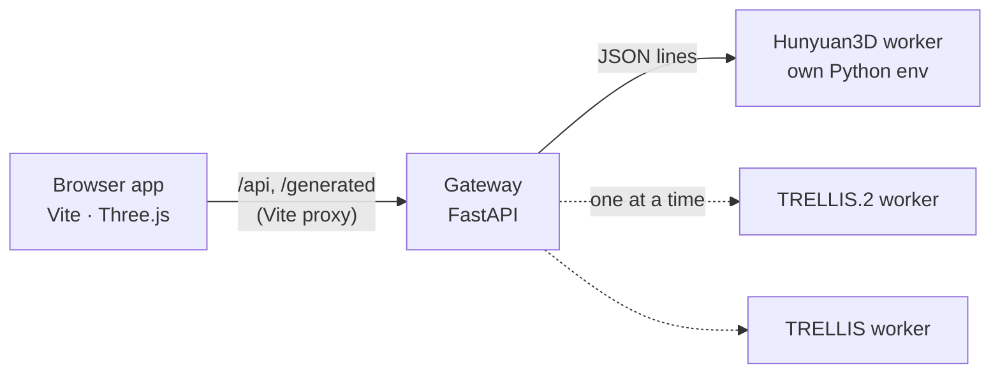

# Room Setup

**English** | [日本語](README.ja.md) | [简体中文](README.zh-CN.md) | [한국어](README.ko.md)

Plan a room in 2D, walk around it in 3D, and fill it with furniture generated from a single photo. Everything runs locally: the web app works on its own, and an optional generation API drives image-to-3D models such as **Hunyuan3D 2.1**, **TRELLIS.2**, **TRELLIS**, **Pixal3D** and **SAM 3D Objects** on your own GPU. You can switch between engines from the app; the API loads and unloads them for you.

<p align="center">
  
</p>

## See it in action


## Example: try it in your room before you buy

Found furniture or a gadget you like in an online shop? Take a screenshot of the product photo, enter its size and generate a 3D model. It's placed in your room at real scale, so you can see how it fits and how it looks before you order.



<sub>The shop in this video is a mock page made for the demo from our own photo. Generation is shown at 10× speed.</sub>

## Features

<table>
  <tr>
    <td width="50%"></td>
    <td width="50%"></td>
  </tr>
</table>

- **Floor plan editor**: draw walls with grid and corner snapping, Shift to lock angles, drag corners or whole walls (connected walls follow), undo/redo, pan and zoom, rectangle and L-shaped templates, live lengths and floor area.
- **Doors and windows**: hinged, double, sliding doors and open doorways; sliding, patio, fixed, casement and high windows. Set width, height and sill height, drag them along a wall, flip a door's hinge or swing. They're cut into the 3D walls with frames and glass.
- **Lighting**: give a generated lamp a light source that moves with it, or place ceiling lights, pendants, downlights, spots, floor and table lamps. Set brightness (lumens), colour temperature and shadows, move lights in the plan or with 3D arrows, and switch between morning, day, evening and night, with sunlight coming in through the windows.
- **3D room**: shadows, environment lighting, a dollhouse cutaway that lowers the walls facing the camera, overview/top/eye-level cameras, and move/rotate gizmos for furniture.
- **Finishes**: procedural flooring and wallpaper presets, pattern scale, your own photos as textures, and per-wall wallpaper.
- **Furniture from a photo**: drop or paste an image, enter width × depth × height, pick an engine and generate. Jobs queue up, show their progress, and the result is scaled to your dimensions and placed in the room. Furniture also appears in the plan view, where you can drag it around.
- **Shape tweaks**: flip models generated upside down or on their side, adjust overall proportions, or pick vertices and deform part of a model.
- **Build it with an AI assistant**: an MCP server lets Claude (or any MCP client that understands images) recreate your room from photos, a floor plan and product links. Its changes appear live in the app. See [docs/mcp.md](docs/mcp.md).
- **Projects**: save and open everything (walls, finishes, furniture models, thumbnails) as one ZIP. Projects from the original Room Designer app open too.
- Light and dark themes, Japanese and English UI, keyboard shortcuts.

## Quick start

Requirements: Node.js 22.12+, a WebGL-capable desktop browser. The generation API needs Python 3.10+.

```bash
npm ci
npm run dev            # http://127.0.0.1:5173
```

Planning, finishes and opening saved projects work without the API. To try the generation flow without a GPU, run the API with the built-in mock engine (it returns a box):

```bash
python3 -m venv .venv
.venv/bin/pip install -r server/requirements.txt
ROOM_SETUP_MOCK_ENGINE=1 npm run api      # in a second terminal
```

## Generation engines


| Engine | Output | Notes |
|---|---|---|
| [Hunyuan3D 2.1](https://github.com/Tencent-Hunyuan/Hunyuan3D-2.1) | Shape, optional PBR texture | Texturing is slower and needs more GPU memory. Has its own, more restrictive license (see below). |
| [TRELLIS.2](https://github.com/microsoft/TRELLIS.2) | Shape with PBR materials | Most detailed results. |
| [TRELLIS](https://github.com/microsoft/TRELLIS) | Coloured mesh | Fast. |
| [Pixal3D](https://github.com/TencentARC/Pixal3D) | Shape with PBR materials | Follows the photo closely. MIT, but downloads Meta's DINOv3 (own license). |
| [SAM 3D Objects](https://github.com/facebookresearch/sam-3d-objects) | Textured mesh | Robust on cluttered real-world photos. Meta SAM License; gated weights. |

### GPU memory

All engines need an NVIDIA GPU with CUDA and have been tested on Linux with an RTX 4090 (24 GB).

| Engine | Minimum VRAM | Recommended |
|---|---|---|
| Hunyuan3D 2.1 | 10 GB (shape only) | 24 GB (with texture; texturing alone needs about 21 GB) |
| TRELLIS.2 | 24 GB | 24 GB+ |
| TRELLIS | 16 GB | 16 GB+ |
| Pixal3D | 24 GB (low-VRAM mode, the default here) | 24 GB+ |
| SAM 3D Objects | 24 GB with this project's settings (upstream asks for 32 GB) | 32 GB |

Minimums come from each upstream project except where noted; only one engine uses the GPU at a time, so the largest one you install sets the requirement.

Each engine stays in its own Python environment; this project does not bundle any model code or weights. Install the ones you want by following their upstream instructions, then point the API at them:

```bash
cp .env.example .env    # set HUNYUAN3D_PYTHON / HUNYUAN3D_ROOT, TRELLIS2_…, TRELLIS_…
npm run api
```

The engine list in the app shows which engines are set up and whether each is idle, loading or ready. The selected engine is loaded when a job needs it; whichever engine held the GPU before is shut down first, so only one model occupies VRAM at a time. See **[docs/engines.md](docs/engines.md)** for setup details, GPU memory, troubleshooting, and how to add another engine.

## Building your room with an assistant

With the API and the app running, register the MCP server with your assistant:

```bash
claude mcp add room-setup -- "$PWD/.venv/bin/python" "$PWD/server/mcp_server.py"
```

Then send it your room photos (from the middle of the room towards each corner), the floor plan and links to your furniture, and ask it to build the room. Setup for Claude Desktop, tips and the tool list are in **[docs/mcp.md](docs/mcp.md)**.

## Using the app

1. **Room** tab: pick a template or draw walls in the plan (`W`). Use `V` to move corners and walls, `E` to erase. Set the ceiling height. Under **Doors & windows**, pick a preset and click a wall to place it; select it to change its size, sill height or swing.
2. **Finishes** tab: choose flooring and wallpaper, adjust the pattern size, or use “+” for your own image. To change a single wall, select it in the plan and choose “Selected wall only”.
3. **Furniture** tab: drop/paste a photo, enter its size, pick an engine and click **Generate 3D model**. You can queue several.
4. Switch to **3D** to look around, click furniture to select it, and drag the gizmo. The inspector lets you rename, position, rotate, duplicate, delete or adjust the shape.
5. **Save** downloads `room-project.zip`; **Open** restores it. While the API is running, the current room is also kept by the API and comes back after a reload. Without the API, nothing is saved automatically.

| Shortcut | Action |
|---|---|
| `W` / `V` / `E` | Draw walls / select & move / erase (plan) |
| `Shift` while drawing | Lock to 45° steps |
| `Space` + drag, middle or right drag, wheel | Pan and zoom the plan |
| `F` | Fit the plan to the view |
| `Ctrl+Z` / `Ctrl+Shift+Z` | Undo / redo walls |
| `R` / `Shift+R` | Rotate the selected furniture by 90° |
| `Delete` | Delete the selected furniture or wall |
| `Ctrl+S` | Save the project |
| `Esc` | Cancel / deselect |

## How it fits together



The browser only talks to its own origin; Vite forwards API calls, so the gateway stays on `127.0.0.1` and needs no CORS. Developer notes and the API reference are in [docs/development.md](docs/development.md).

## Using images responsibly

Photos you feed into the generator, such as product images from online shops, usually belong to someone else. Only use images you have the right to use. Please keep models generated from other people's images to personal use (planning your own room): don't redistribute or sell them, and take care with logos and trademarks that show up in textures. The best input is a photo you took yourself.

## Security

This is a single-user tool for your own machine. The app and API have **no authentication** (the API does refuse requests from other websites). Keep both bound to localhost (the default). If you expose the dev server on a LAN with `HOST=0.0.0.0`, do so only on a network you trust, and never on the public Internet.

## License

Room Setup's own code is [MIT](LICENSE). Generation engines, model weights and their outputs are covered by their own terms. In particular, **Tencent Hunyuan 3D 2.1** has territorial restrictions and other conditions that this project's MIT license does not change. Read [THIRD_PARTY_NOTICES.md](THIRD_PARTY_NOTICES.md) before using or distributing generated models.

Contributions are welcome; see [CONTRIBUTING.md](CONTRIBUTING.md).
