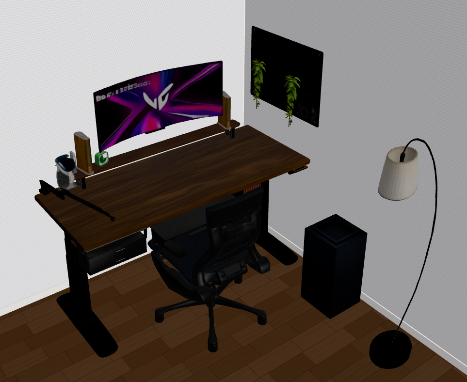
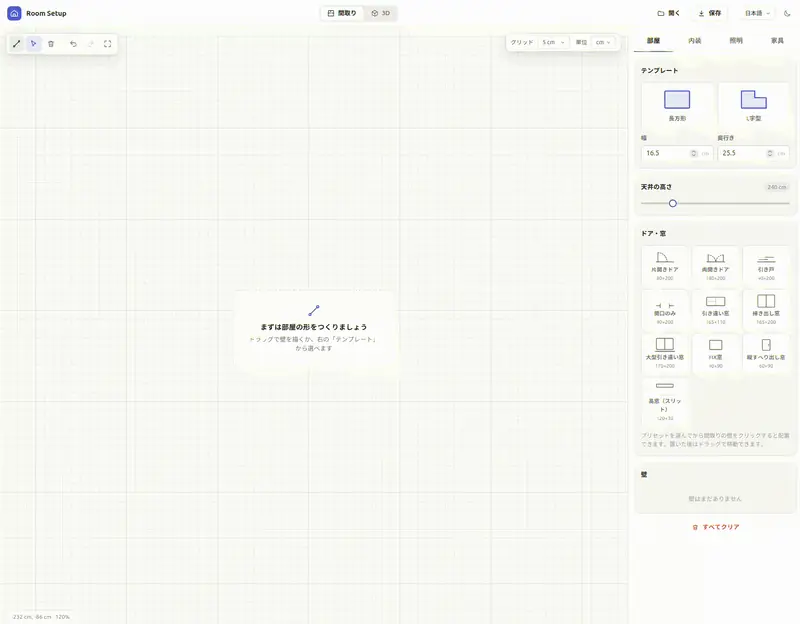
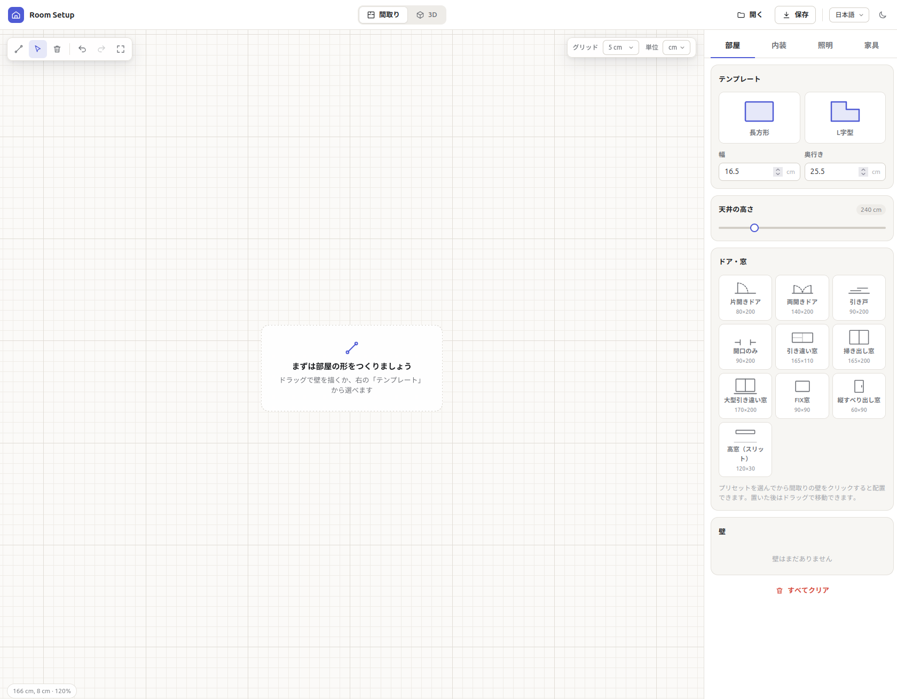
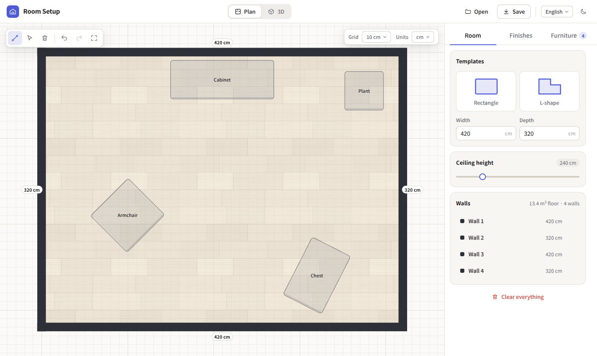
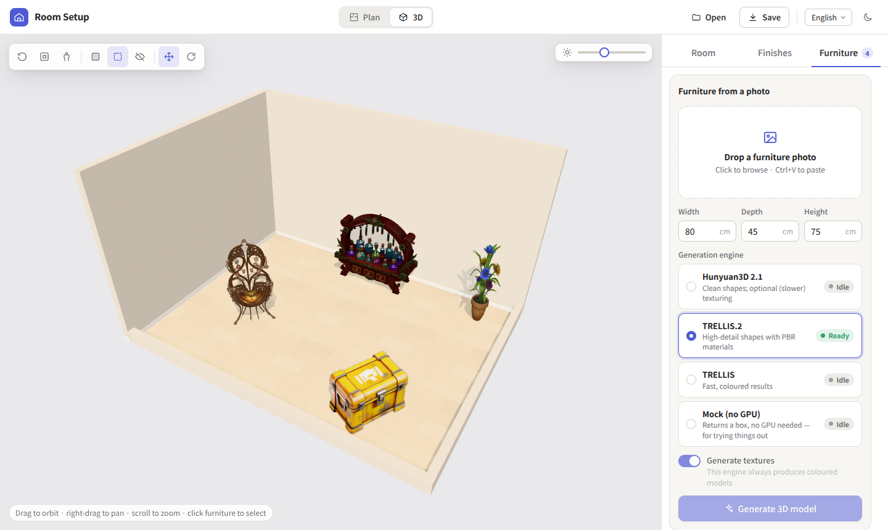
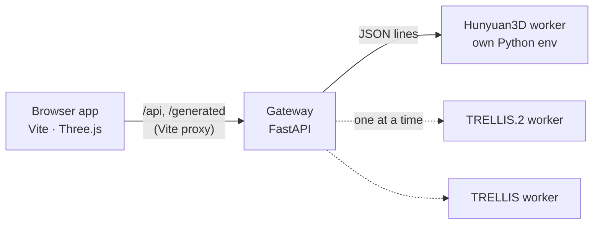

# Room Setup

[English](README.md) | [日本語](README.ja.md) | **简体中文** | [한국어](README.ko.md)

在 2D 中规划房间，在 3D 中四处查看，并用一张照片生成家具摆进房间。一切都在本地运行：网页应用可以单独使用，可选的生成 API 会在你自己的 GPU 上驱动 **Hunyuan3D 2.1**、**TRELLIS.2**、**TRELLIS**、**Pixal3D**、**SAM 3D Objects** 等图像转 3D 模型。可以在应用中切换引擎，API 会自动加载和卸载它们。

<p align="center">
  
</p>

## 演示



## 功能

<table>
  <tr>
    <td width="50%"></td>
    <td width="50%"></td>
  </tr>
</table>

- **平面图编辑器**：支持网格和墙角吸附的墙体绘制，按住 Shift 锁定角度，拖动墙角或整面墙（相连的墙会跟随），撤销/重做，平移和缩放，矩形和 L 形模板，实时显示长度和地板面积。
- **门和窗**：平开门、双开门、推拉门和无门洞口；推拉窗、落地推拉窗、固定窗、平开窗和高窗。可设置宽度、高度和窗台高度，沿墙拖动位置，翻转门的合页方向或开启方向。它们会在 3D 墙体上开洞，并带有框和玻璃。
- **照明**：给生成的台灯/落地灯添加随其移动的光源，或放置吸顶灯、吊灯、筒灯、射灯、落地灯和台灯。可设置亮度（流明）、色温和阴影，在平面图中或用 3D 箭头移动灯光，并在早晨、白天、傍晚和夜晚之间切换，阳光会从窗户照进来。
- **3D 房间**：阴影、环境光照、自动降低朝向相机一侧墙体的剖切视图（娃娃屋视图）、俯瞰/顶视/人眼高度相机，以及用于家具的移动/旋转控件。
- **装修材质**：程序生成的地板和壁纸预设、图案缩放、用自己的照片作为纹理，以及按墙设置壁纸。
- **从照片生成家具**：拖放或粘贴图片，输入宽 × 深 × 高，选择引擎后生成。任务会排队并显示进度，结果会按你的尺寸缩放并放入房间。家具也会显示在平面图中，可以直接拖动。
- **形状调整**：翻转上下颠倒或侧倒生成的模型，调整整体比例，或选取顶点使模型局部变形。
- **用 AI 助手搭建**：通过 MCP 服务器，Claude（或任何能理解图片的 MCP 客户端）可以根据照片、平面图和商品链接重现你的房间，修改会实时显示在应用中。参见 [docs/mcp.md](docs/mcp.md)。
- **项目**：将所有内容（墙体、材质、家具模型、缩略图）保存为一个 ZIP 并重新打开。也能打开原 Room Designer 应用的项目。
- 浅色和深色主题，日语和英语界面，键盘快捷键。

## 快速开始

要求：Node.js 22.12+，支持 WebGL 的桌面浏览器。生成 API 需要 Python 3.10+。

```bash
npm ci
npm run dev            # http://127.0.0.1:5173
```

规划、装修和打开已保存的项目不需要 API。若想在没有 GPU 的情况下体验生成流程，可以用内置的模拟引擎运行 API（它会返回一个方块）：

```bash
python3 -m venv .venv
.venv/bin/pip install -r server/requirements.txt
ROOM_SETUP_MOCK_ENGINE=1 npm run api      # 在另一个终端中运行
```

## 生成引擎



| 引擎 | 输出 | 说明 |
|---|---|---|
| [Hunyuan3D 2.1](https://github.com/Tencent-Hunyuan/Hunyuan3D-2.1) | 形状，可选 PBR 纹理 | 纹理生成较慢，需要更多显存。有自己的、限制更多的许可证（见下文）。 |
| [TRELLIS.2](https://github.com/microsoft/TRELLIS.2) | 带 PBR 材质的形状 | 细节最丰富。 |
| [TRELLIS](https://github.com/microsoft/TRELLIS) | 带颜色的网格 | 速度快。 |
| [Pixal3D](https://github.com/TencentARC/Pixal3D) | 带 PBR 材质的形状 | 与照片高度一致。MIT 许可，但会下载 Meta 的 DINOv3（有自己的许可证）。 |
| [SAM 3D Objects](https://github.com/facebookresearch/sam-3d-objects) | 带纹理的网格 | 对杂乱的真实照片也很稳健。Meta SAM License；权重需申请访问。 |

每个引擎都运行在各自的 Python 环境中；本项目不附带任何模型代码或权重。请按照各上游项目的说明安装需要的引擎，然后告诉 API 它们的位置：

```bash
cp .env.example .env    # 设置 HUNYUAN3D_PYTHON / HUNYUAN3D_ROOT、TRELLIS2_…、TRELLIS_…
npm run api
```

应用中的引擎列表会显示哪些引擎已配置，以及各自处于空闲、加载中还是就绪状态。所选引擎会在任务需要时加载；之前占用 GPU 的引擎会先被关闭，因此同一时间只有一个模型占用显存。安装细节、GPU 内存、故障排除以及如何添加新引擎，请参见 **[docs/engines.md](docs/engines.md)**。

## 用 AI 助手搭建房间

在 API 和应用运行时，向你的助手注册 MCP 服务器：

```bash
claude mcp add room-setup -- "$PWD/.venv/bin/python" "$PWD/server/mcp_server.py"
```

然后发送房间照片（从房间中央朝各个角落拍摄）、平面图和家具链接，请它搭建房间即可。Claude Desktop 的设置、技巧和工具列表见 **[docs/mcp.md](docs/mcp.md)**。

## 使用方法

1. **房间**标签页：选择模板，或在平面图中绘制墙体（`W`）。用 `V` 移动墙角和墙体，用 `E` 擦除。设置天花板高度。在**门和窗**中选择预设并点击墙体放置；选中后可修改尺寸、窗台高度或开启方向。
2. **装修**标签页：选择地板和壁纸，调整图案大小，或用“+”使用自己的图片。要只修改一面墙，请在平面图中选中它并选择“仅所选墙”。
3. **家具**标签页：拖放/粘贴照片，输入尺寸，选择引擎并点击**生成 3D 模型**。可以排队多个任务。
4. 切换到 **3D** 四处查看，点击家具选中它并拖动控件。检查器中可以重命名、调整位置、旋转、复制、删除或调整形状。
5. **保存**会下载 `room-project.zip`；**打开**可以恢复它。API 运行时，当前房间也会由 API 保存，重新加载页面后会恢复。没有 API 时不会自动保存。

| 快捷键 | 操作 |
|---|---|
| `W` / `V` / `E` | 绘制墙体 / 选择并移动 / 擦除（平面图） |
| 绘制时按住 `Shift` | 锁定为 45° 步进 |
| `Space` + 拖动、中键或右键拖动、滚轮 | 平移和缩放平面图 |
| `F` | 使平面图适应视图 |
| `Ctrl+Z` / `Ctrl+Shift+Z` | 撤销 / 重做墙体操作 |
| `R` / `Shift+R` | 将所选家具旋转 90° |
| `Delete` | 删除所选家具或墙体 |
| `Ctrl+S` | 保存项目 |
| `Esc` | 取消 / 取消选择 |

## 整体结构



浏览器只与自己的源通信；Vite 转发 API 请求，因此网关保持在 `127.0.0.1` 上，不需要 CORS。开发者说明和 API 参考见 [docs/development.md](docs/development.md)。

## 关于图片的使用

用于生成的照片（例如网店的商品图片）通常属于他人。请只使用你有权使用的图片。用他人的图片生成的模型请仅限个人使用（例如规划自己的房间），不要再分发或出售，并注意纹理中出现的标志和商标。最稳妥的做法是使用你自己拍摄的照片。

## 安全

这是一个在自己电脑上使用的单用户工具。应用和 API **没有身份验证**（API 会拒绝来自其他网站的请求）。请让两者都只绑定在 localhost（默认设置）。如果用 `HOST=0.0.0.0` 在局域网中公开开发服务器，请只在可信的网络中这样做，绝不要暴露到公共互联网。

## 许可证

Room Setup 自身的代码采用 [MIT](LICENSE) 许可。生成引擎、模型权重及其输出受各自条款约束。特别是 **Tencent Hunyuan 3D 2.1** 有地域限制和其他条件，本项目的 MIT 许可证不会改变这些条件。使用或分发生成的模型前，请阅读 [THIRD_PARTY_NOTICES.md](THIRD_PARTY_NOTICES.md)。

本译文仅供参考；如有出入，以[英文版](README.md)为准。

欢迎贡献，参见 [CONTRIBUTING.md](CONTRIBUTING.md)。
